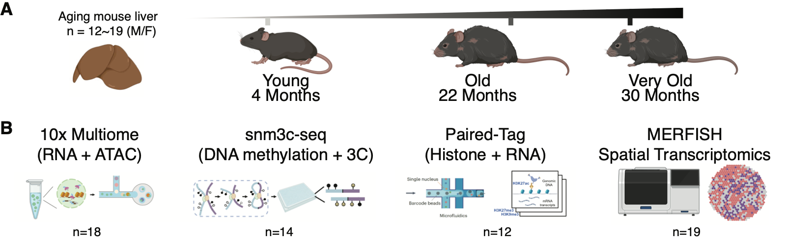

# Spatial and epigenetic programs underlie heterogeneous cellular senescence in the aging liver

This repository organizes the analysis code for a study of cellular senescence in the aging mouse liver using 10x Multiome, Paired-Tag, snm3C-seq, and MERFISH.

## Analysis workflows

| Directory | Analysis |
| --- | --- |
| [`analysis/MERFISH/processing/`](analysis/MERFISH/processing/) | Prepare MERFISH expression, cell annotations, and spatial coordinates. |
| [`analysis/MERFISH/SnC_mapping/`](analysis/MERFISH/SnC_mapping/) | Use the 10x Multiome reference and SenLearner outputs to map senescent cells into MERFISH. |
